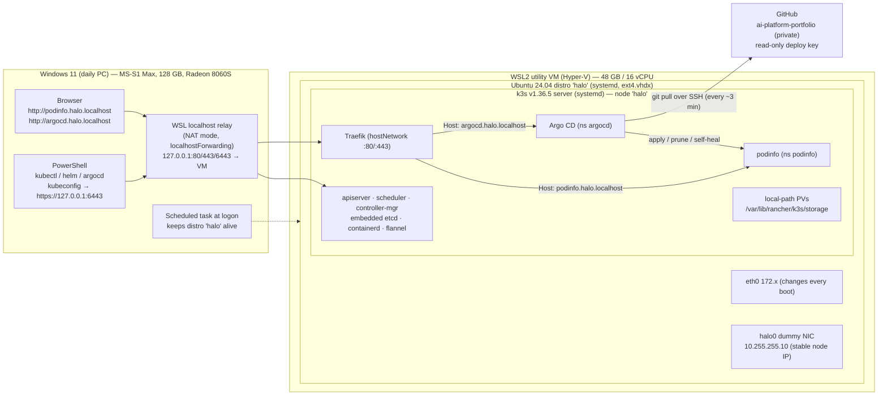

# L1 · Week 1: k3s on WSL2 + Argo CD (cluster **halo**)

> **Rev 2, Nov 2 2026: CI is GitHub Actions only; Jenkins removed.**

**Checkpoint:** *Argo CD syncing a sample app from Git.*
**Framing:** a production-style platform built on one box. Every choice is the one a large organisation would make, scaled down. The end goal is to self-host several LLMs on Kubernetes so you stop paying per token.
**Day-job angle (patterns, never data):** a GitOps paved road on GitHub Actions that I can pitch at work as the modern path off Jenkins.

| Part | File | Steps | Blocks |
|---|---|---|---|
| Overview (this page) | `README.md` | versions, architecture, plan, assumptions | — |
| Windows + WSL foundation | [`01-windows-wsl.md`](01-windows-wsl.md) | Step 0 | B1, B2 |
| k3s, clients, verification | [`02-k3s-cluster.md`](02-k3s-cluster.md) | Steps 1–3 | B3, B4 |
| Monorepo + GitOps layout | [`03-monorepo-gitops-layout.md`](03-monorepo-gitops-layout.md) | Step 4 | B5 |
| Argo CD, app of apps, podinfo | [`04-argocd-app-of-apps.md`](04-argocd-app-of-apps.md) | Steps 5–7 | B6, B7 |
| Prove GitOps, rebuild, self-manage | [`05-prove-rebuild.md`](05-prove-rebuild.md) | Steps 8–10 | B8, B9, (B10) |
| Troubleshooting, glossary, final checklist, what's next | [`06-appendix.md`](06-appendix.md) | — | — |

---

## Version table (checked 2026-11-02)

| Component | Pinned version | Released | Source |
|---|---|---|---|
| WSL (Store package) | **3.0.5** | 2026-10-29 | <https://github.com/microsoft/WSL/releases> |
| Ubuntu WSL image | **Ubuntu-24.04** → 24.04.5 | 24.04.5 point release | <https://github.com/microsoft/WSL/blob/master/distributions/DistributionInfo.json> |
| WSL kernel (info only, ships with WSL) | 6.18.x | — | <https://github.com/microsoft/WSL2-Linux-Kernel> |
| k3s | **v1.36.5+k3s1** | 2026-09-24 | <https://github.com/k3s-io/k3s/releases/tag/v1.36.5%2Bk3s1> |
| kubectl | **v1.36.6** | — | <https://dl.k8s.io/release/stable-1.36.txt> |
| Helm | **v4.3.1** | 2026-10-14 | <https://github.com/helm/helm/releases/tag/v4.3.1> |
| Argo CD Helm chart `argo/argo-cd` | **10.11.6** (appVersion **v3.5.6**) | 2026-10-26 | <https://github.com/argoproj/argo-helm/releases/tag/argo-cd-10.11.6> |
| argocd CLI | **v3.5.6** | 2026-10-20 | <https://github.com/argoproj/argo-cd/releases/tag/v3.5.6> |
| Sample app image | **ghcr.io/stefanprodan/podinfo:6.17.0** | 2026-10-26 | <https://github.com/stefanprodan/podinfo/releases/tag/6.17.0> |
| busybox (PVC smoke test) | **busybox:1.37.0** | — | <https://hub.docker.com/_/busybox> |
| k9s (optional) | **v0.51.0** | 2026-06-05 | <https://github.com/derailed/k9s/releases/tag/v0.51.0> |
| Traefik, CoreDNS, local-path, metrics-server | bundled with the k3s release (not pinned separately) | — | k3s release notes (link above) |

**Why these versions**
- **k3s v1.36.5, not v1.37.1.** 1.37 is the newest minor. Production teams run n-1, and k3s's own `stable` channel usually tracks n-1. The CKA usually runs one or two minors behind upstream (most likely 1.35 or 1.36 right now). Check the version for your exam date on the [CNCF CKA page](https://training.linuxfoundation.org/certification/certified-kubernetes-administrator-cka/). kubectl 1.36.6 is within the supported ±1 minor skew.
- **Helm 4** is current (Helm 3 only gets security fixes). For you, the main change is that new installs use server-side apply by default. Every `helm` command in this guide works the same way on Helm 4.
- **Argo CD 3.x.** Changes since 2.x that matter here: resource tracking uses annotations by default, and RBAC for logs and fine-grained update/delete is enforced. The chart is now at major version 10.
- **WSL 3.0.x.** Every `.wslconfig` key used here was checked against the WSL source at that version.

> **Caveat:** my build sandbox couldn't reach `update.k3s.io` or `argoproj.github.io`, so I took versions from the Git tags and the chart's `Chart.yaml`. Run this 30-second re-check in WSL once Step 0 is done:
> ```bash
> curl -s https://update.k3s.io/v1-release/channels | jq -r '.data[] | select(.id=="stable" or .id=="v1.36") | "\(.id) \(.latest)"'
> helm repo add argo https://argoproj.github.io/argo-helm >/dev/null; helm repo update >/dev/null; helm search repo argo/argo-cd --versions | head -3
> ```
> If `v1.36` shows a newer patch than v1.36.5+k3s1, you can use it. Change the version in one place: `platform/k3s/halo/install-k3s.sh`.

---

## Assumptions (I went with defaults; each one has a check in Step 0)

| # | Assumption | Where it's checked or changed |
|---|---|---|
| A1 | Windows 11 23H2 or later. Nothing here needs mirrored mode, so build number matters little | Step 0.1 |
| A2 | No Docker Desktop, or you remove its `kubectl` from PATH | Step 0.1 (check + fix) |
| A3 | WSL gets **48 GB RAM, 16 logical CPUs, 16 GB swap**. Shrink it if your BIOS gives the GPU a big share of RAM (table in Step 0.3) | Step 0.3 |
| A4 | The WSL disk stays on C:. Use `--location D:\WSL\halo` if you have a second NVMe | Step 0.2 |
| A5 | GitHub user `nikhilgs817` (inferred from your other repo). If it's different, replace it everywhere with one `sed` (Step 4) | Step 4 |
| A6 | The PC doesn't sleep on AC power (Phoenix has to run around the clock) | Step 0.6 |
| A7 | The guide lives in the `certifiaction` repo. You type the files into `ai-platform-portfolio` yourself | — |

---

## Architecture



**Network path from a Windows browser to the app:**
`podinfo.halo.localhost` → the browser resolves `*.localhost` to 127.0.0.1 itself (no DNS involved) → Windows `127.0.0.1:80` → WSL localhost relay → Traefik bound on `:80` in the distro's network namespace (hostNetwork) → Ingress rule matches `Host` → Service `podinfo` (ClusterIP) → pod IP on flannel `10.42.0.0/16`.

### Three design decisions everything else depends on

1. **NAT networking + a stable dummy-interface node IP (recommended), not mirrored.**
   - **NAT** gives the distro one simple `eth0` on a private 172.x subnet, and its IP changes on every boot. k3s doesn't care, because the node is pinned to `halo0` = `10.255.255.10`, a dummy interface that never changes. Windows reaches the cluster through *localhost forwarding*. That forwarding only relays real listening sockets, which is why Traefik binds ports 80/443 directly (hostNetwork) instead of through ServiceLB's iptables rules.
   - **Mirrored** mode copies all of Windows' adapters (Wi-Fi, Ethernet, VPN) into Linux. k3s would then auto-detect whichever one is active, so the node IP changes when you switch networks. You'd also get IPv6 `::1` quirks and Hyper-V firewall rules on inbound traffic. You'd gain only one thing: other LAN devices (your phone viewing the Phoenix dashboard) could reach the cluster directly. Because the node IP is pinned, switching to mirrored later is a one-line `.wslconfig` change. Defer that decision.
2. **Embedded etcd (`cluster-init: true`), not k3s's default SQLite.** This matches production and lets you practise CKA etcd snapshot and restore. etcd hates IP changes, and the stable dummy IP is what makes it safe in WSL.
3. **One root Application per cluster (`clusters/halo`) plus Kustomize overlays per environment.** The future `aws` cluster gets its own root (`clusters/aws`) and its own overlays, and nothing has to move.

### Lab vs production (what this box simplifies, and what replaces it later)

| Concern | halo (this week) | Large-org production | When you close the gap |
|---|---|---|---|
| Control plane | 1 node, embedded etcd | 3 control-plane nodes + workers, HA etcd | CKA kubeadm practice; `aws` cluster |
| Ingress edge | Traefik hostNetwork on one node | Cloud LB → ingress controller fleet | `aws` overlay |
| TLS | none (http on `*.localhost`) | cert-manager + internal CA / ACME | after week 1 |
| Argo CD auth | local `admin`, password in password manager | SSO (OIDC), `admin.enabled: false`, RBAC per team | later |
| Git access | read-only deploy key | GitHub App with org-scoped permissions | later |
| Secrets | created by CLI, never in Git | Sealed Secrets / External Secrets + Vault / AWS SM | after week 1 |
| Images | public registries | Harbor proxy-cache + Trivy + cosign + Kyverno | L1 weeks 2–4 |
| Bootstrap | 2 shell scripts in Git | Terraform + Ansible + Argo CD bootstrap | Terraform for AWS |
| Storage | local-path (single disk, no replication) | CSI with replication/snapshots (EBS, Longhorn, Ceph) | Phoenix: backups first |

---

## Time plan (90-minute blocks, each one ends in a working state)

| Block | Steps | Ends with (working state) |
|---|---|---|
| **B1** | 0.1–0.5 BIOS/Windows checks, WSL install, `.wslconfig`, `wsl.conf` | `wsl -d halo` opens a shell, hostname `halo`, systemd running |
| **B2** | 0.6–0.9 kernel prerequisites, keep-alive task, sleep settings, **baseline export** | `halo-baseline.tar` safe on disk |
| **B3** | 1 k3s install (stable IP, etcd, Traefik config) | `kubectl get nodes` → `halo Ready` inside WSL |
| **B4** | 2–3 client tools on both sides, smoke tests, restart test | Browser on Windows opens `hello.halo.localhost`; survives `wsl --shutdown` |
| **B5** | 4 GitHub repo, monorepo skeleton, ADR-0001, GitOps folders | First commit pushed to `main` |
| **B6** | 5 Argo CD via Helm, UI via Traefik, password rotated, repo connected | Argo CD UI reachable, repo status *Successful* |
| **B7** | 6–7 AppProjects, root app, podinfo base + halo overlay | **Checkpoint hit:** podinfo deployed by Argo CD from Git |
| **B8** | 8a–8f the six GitOps proofs | Each proof ticked, history visible |
| **B9** | 9 rebuild drill + runbook | `docs/runbooks/rebuild-halo.md` with measured times |
| *B10* | *10 optional: Argo CD manages itself* | *Argo CD Application `argocd` Synced* |

If you only get 6 blocks this week, stop after **B7**. That's the checkpoint. B8 and B9 can move to next week without leaving anything broken.

---

## Conventions used in every step

- **Where to run** tags: 🪟A = Windows PowerShell **as Administrator** · 🪟 = Windows PowerShell (normal) · 🐧 = WSL Ubuntu shell (`wsl -d halo`) · 🌐 = browser · 🐙 = GitHub web UI.
- Commands are copy-paste. Files are written with `cat > path <<'EOF'` so you get the exact path and the full contents in one block.
- `- [ ]` boxes are for you to tick.
- Every major step ends with **CKA corner**, **Interview angle** and **Phoenix angle**.

---

## Sources and references
- WSL configuration (`.wslconfig`, `wsl.conf`): <https://learn.microsoft.com/windows/wsl/wsl-config>
- WSL networking modes: <https://learn.microsoft.com/windows/wsl/networking>
- WSL disk management: <https://learn.microsoft.com/windows/wsl/disk-space>
- k3s configuration file and server flags: <https://docs.k3s.io/installation/configuration> · <https://docs.k3s.io/cli/server>
- k3s networking (Traefik, ServiceLB): <https://docs.k3s.io/networking/networking-services>
- k3s embedded etcd + snapshots: <https://docs.k3s.io/datastore/ha-embedded> · <https://docs.k3s.io/cli/etcd-snapshot>
- Argo CD declarative setup, projects, app of apps: <https://argo-cd.readthedocs.io/en/stable/operator-manual/declarative-setup/> · <https://argo-cd.readthedocs.io/en/stable/operator-manual/cluster-bootstrapping/>
- Argo CD Helm chart: <https://github.com/argoproj/argo-helm/tree/main/charts/argo-cd>
- AMD ROCm on WSL (Ryzen / Strix Halo): <https://rocm.docs.amd.com/projects/radeon-ryzen/en/latest/docs/install/installryz/wsl/howto_wsl.html> · Phoronix, ROCDXG for WSL: <https://www.phoronix.com/news/AMD-WSL-ROCm-ROCDXG>
